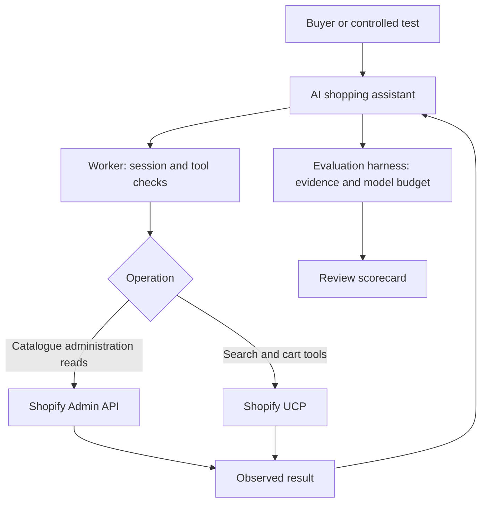

# How this shopping assistant works

This guide explains the project you can demonstrate and the evidence you should discuss with a client. A working integration and an honest account of its limits are useful deliverables. They do not establish expertise or guarantee a client engagement.

## What we built

We connected application code to **Karachi Kicks SupportOps Lab**, a real Shopify development store. Shopify actually stores the products and processes the API calls. The 318 products we added are synthetic testing data, not a real merchant's commercial inventory. The original 18 products were preserved.

A development store lets us exercise real integration behavior without representing the result as a production launch. This project has not proven real payments, order handling or customer-data processing.

## The request journey

The assistant interprets a request, such as finding a shoe in a particular size. It asks a tool to retrieve facts. The Worker is the application service between the assistant and Shopify: it validates requests, manages session ownership and returns results. The assistant should explain those results without inventing availability, prices or successful actions.

The controlled evaluation uses a local loop with an n8n model helper. It is separate from the published hosted-chat workflow. Passing a local test does not prove that an unchanged hosted workflow behaves identically.

## Two credentials, two different purposes

The **runtime app** is used by the running application. Its Shopify Admin permissions are only `read_products` and `read_publications`. Tests confirmed that it cannot read customers or orders.

The **seed app** has the separately approved write permissions needed to prepare catalogue fixtures. A fixture is controlled test data. Seeding should be repeatable without duplicating or modifying unrelated products: its repeat run skipped all 318 seeded products and sent zero Admin mutation requests.

These Admin permissions are separate from **UCP authentication**. The UCP calls currently identify no authenticated agent. Changing an Admin secret does not automatically authenticate those calls. Authenticated UCP access is a production requirement that remains unimplemented. The shared SupportOps app must stay separate.

## Sessions protect ownership

A session represents one shopper's interaction. Its cart belongs to that session. A shared application secret only proves that a caller knows the secret; it does not establish which shopper owns a cart. The application therefore needs session-level ownership checks so one session cannot use another session's cart.

A cancellation acknowledgement means the cancellation request received a successful response. A separate absence check provides additional evidence that the cart is no longer available. Six earlier load-test carts have cancellation acknowledgements but unconfirmed absence: “cancellation acknowledged, absence unconfirmed; carts expire”. Their expiry was not observed. The later evaluation separately recorded 36 sessions cleaned with verified absence and no pending restoration. These are different sets of sessions; do not combine their claims.

## Why requests sometimes stop

**HTTP 429** means the provider is limiting requests. **Retry-After** tells the client how long to wait. It is a provider instruction, not an application defect by itself. It also does not explain every earlier failed test.

Our anonymous UCP requests were throttled during a test with 20 overlapping sessions. Requests went over the network one at a time; this was not 20 simultaneous HTTP calls. The first load attempt also had search failures whose historical cause remains unknown. Later successful searches do not erase that failure.

The completed evaluation spaced requests ten seconds apart. Its rule was to pause on any live429 for Retry-After plus 15 minutes; this evaluation recorded no live429 suspension. Slower requests reduce pressure but do not guarantee access. No further load test is in scope.

## Read the tests in layers

| Evidence | What it tells you | What it does not tell you |
|---|---|---|
| Deterministic code tests | Specific code behavior met controlled expectations | Live Shopify will always behave the same way |
| Live read-only checks | Particular real requests succeeded | Cart, payment or production capacity is proven |
| Browser cart smoke | One observed cart lifecycle worked | Every shopper or agent scenario works |
| AI scenario tests | The assistant's recorded decisions under specific conditions | Every answer is safe or correct |
| Human transcript review | A person checked claims against actual tool evidence | Untested conditions are covered |

The completed evaluation selected **33 attempt slots**: S05, S19, S20 and S21 run three times each, followed by one attempt for each of the other 21 scenarios. Those labels refer to the scenario definitions in the repository. This was not the original 75-attempt suite: 42 repetitions stayed out of scope. It used five iterations per conversation turn and finished on 11 November before the authorized cutoff.

An iteration is a turn through the agent's reasoning/tool loop. More iterations can increase time and cost; raising the limit is not automatically a fix. Actual results are **32 failed, one blocked, zero passed**. All 12 safety-critical repetitions failed. All selected slots stopped with an outcome, but most planned conversation turns never ran. There are no mechanical successes to accept; human review remains pending. A mechanical success in a future retest would still need human transcript review.

## What the failures teach us

The most common failure was at the boundary between two programs. The model provider can return multiple content blocks. In the inspected execution, it returned both a thinking block and text. Our connector expected every block to be text and rejected the response. Twenty-six attempts recorded that content-format rejection. This does not tell us whether the intended answer would have been correct: the conversation stopped before acceptance checks could establish it. Private thinking content is not part of this public handoff.

Three excluded-product checks failed before the AI was called. Three cross-session checks also failed during preparation. The saved aggregate errors do not identify which individual condition failed. A responsible developer investigates the exact assertion and observed response instead of claiming either a successful attack or proven protection.

Pagination illustrates another practical problem. S13 made one model call, then its next input exceeded the harness bound. Product data and conversation history consume space. A future fix should control what information is passed forward, while retaining the evidence needed for accurate decisions. Increasing a limit without understanding growth is not an acceptance test.

The harness stopped at that bound, confirmed there was no unresolved usage or cleanup, then continued only the nine untouched scenarios. It did not repeat the blocked paid attempt. Every original failure remains in the report.

Stock changes, price changes, publication changes, discount expiry and the 24-turn conversation were not validated because their attempts stopped early. Passing 200 offline tests is useful, but cannot substitute for these live results.

For a concrete business example, a buyer asks for a black size-10 running shoe below USD100. A complete accepted journey would retrieve the exact variant, confirm current price and availability, create a cart only after the buyer asks, and report Shopify's actual result. Today we can show the underlying catalogue and earlier cart smoke evidence. We cannot claim this evaluated AI candidate reliably completes that journey.

## Costs and stopping rules

The harness records model token usage and reconciles spend. The owner ceiling is USD 10; the stricter available-funded stop is USD 1.90. These are model-evaluation limits, not a quote for operating a production service. The final canonical cost is **USD 0.0108549**, including the earlier USD 0.0000141 smoke. It covers 28 model calls: one smoke and 27 evaluation calls, using 83,029 input and 5,104 output tokens. Every reservation is settled; none remains unknown. This low cost reflects early stops, not a fully successful multi-turn demonstration.

Stopping at a limit or provider block must leave an honest result. **NOT_RUN** is not a failure that occurred, and it is not a pass. Missing evidence stays missing.

## A small glossary

| Term | Meaning here |
|---|---|
| API | A defined way for software to request data or actions |
| UCP | Universal Commerce Protocol: shared commerce operations and capability descriptions |
| MCP tool | An operation the assistant can request through a structured tool interface |
| Worker | The application's Cloudflare service code |
| Scope | A permission granted to an application |
| Credential/token | A secret or issued value used to authenticate; separate from model tokens |
| Model token | A unit of model input/output measured for usage and billing |
| Variant | A particular product option combination, such as size and colour |
| Preflight | Checks that the target store and permissions match before writes |
| Idempotent rerun | Repeating preparation without duplicate or unintended changes |
| Session | One interaction's identity and owned state, including its cart |
| Gate | A review checkpoint; reaching it does not mean passing it |
| Harness | Code that runs cases, measures usage and checks results |
| Fixture | Controlled product or other data prepared for a repeatable test |
| Reservation | Budget temporarily held before a model call; settled with actual usage |
| FAILED / BLOCKED | An attempt did not meet checks / could not proceed under a guard |
| PENDING_REVIEW | Mechanical checks succeeded, but a person has not accepted the transcript |
| Pull request | Proposed code changes presented for review before merge |

## What to show a client

Start with [SCORECARD.md](SCORECARD.md). Explain the business behavior, then show its evidence. Distinguish verified facts, unresolved risks and planned work. Say “evaluation completed with failures”, not “assistant validated”. Do not describe the development environment as a production deployment.

After a separately authorized fix and retest, a useful demonstration would be: retrieve a product, explain the source of its price, show session-bound cart behavior, and explain how the application responds when Shopify refuses more requests. Only demonstrate live actions when they are within the current authorization and provider limits.

The final handoff consolidates actual results in one draft review pull request targeting `main`; PR metadata records the superseding link from PR #1. The recommendation is HOLD. Owner approval is required before any merge, release or production deployment. Keep the detailed [Gate 6 report](sdd/GATE-6-REPORT.md) for technical review and [authentication research](sdd/UCP-AUTH-RESEARCH.md) for the unresolved production access work.
