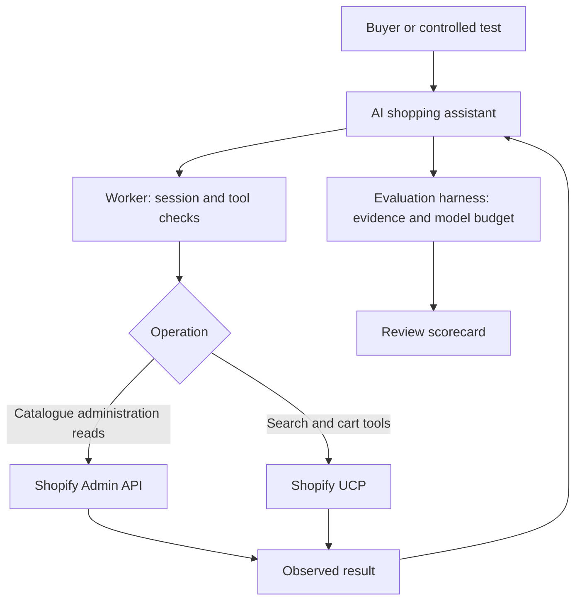

# How this shopping assistant works

This guide explains the project you can demonstrate and the evidence you should discuss with a client. A working integration and an honest account of its limits are useful deliverables. They do not establish expertise or guarantee a client engagement.

## What we built

We connected application code to **Karachi Kicks SupportOps Lab**, a real Shopify development store. Shopify actually stores the products and processes the API calls. The 318 products we added are synthetic testing data, not a real merchant's commercial inventory. The original 18 products were preserved.

A development store lets us exercise real integration behavior without representing the result as a production launch. This project has not proven real payments, order handling or customer-data processing.

## The request journey

The assistant interprets a request, such as finding a shoe in a particular size. It asks a tool to retrieve facts. The Worker is the application service between the assistant and Shopify: it validates requests, manages session ownership and returns results. The assistant should explain those results without inventing availability, prices or successful actions.

The controlled evaluation uses a local loop with an n8n model helper. It is separate from the published hosted-chat workflow. Passing a local test does not prove that an unchanged hosted workflow behaves identically.

## Two credentials, two different purposes

The **runtime app** is used by the running application. Its Shopify Admin permissions are only `read_products` and `read_publications`. Tests confirmed that it cannot read customers or orders.

The **seed app** has the separately approved write permissions needed to prepare catalogue fixtures. A fixture is controlled test data. Seeding should be repeatable without duplicating or modifying unrelated products: its repeat run skipped all 318 seeded products and sent zero Admin mutation requests.

These Admin permissions are separate from **UCP authentication**. The UCP calls currently identify no authenticated agent. Changing an Admin secret does not automatically authenticate those calls. Authenticated UCP access is a production requirement that remains unimplemented. The shared SupportOps app must stay separate.

## Sessions protect ownership

A session represents one shopper's interaction. Its cart belongs to that session. A shared application secret only proves that a caller knows the secret; it does not establish which shopper owns a cart. The application therefore needs session-level ownership checks so one session cannot use another session's cart.

A cancellation acknowledgement means the cancellation request received a successful response. A separate absence check provides additional evidence that the cart is no longer available. Six test carts have cancellation acknowledgements but unconfirmed absence. We must not describe them as verified expired or verified absent.

## Why requests sometimes stop

**HTTP 429** means the provider is limiting requests. **Retry-After** tells the client how long to wait. It is a provider instruction, not an application defect by itself. It also does not explain every earlier failed test.

Our anonymous UCP requests were throttled during a test with 20 overlapping sessions. Requests went over the network one at a time; this was not 20 simultaneous HTTP calls. The first load attempt also had search failures whose historical cause remains unknown. Later successful searches do not erase that failure.

The current evaluation spaces requests ten seconds apart. If a 429 occurs, it pauses for Retry-After plus 15 minutes. Slower requests reduce pressure but do not guarantee access. No further load test is in scope.

## Read the tests in layers

| Evidence | What it tells you | What it does not tell you |
|---|---|---|
| Deterministic code tests | Specific code behavior met controlled expectations | Live Shopify will always behave the same way |
| Live read-only checks | Particular real requests succeeded | Cart, payment or production capacity is proven |
| Browser cart smoke | One observed cart lifecycle worked | Every shopper or agent scenario works |
| AI scenario tests | The assistant's recorded decisions under specific conditions | Every answer is safe or correct |
| Human transcript review | A person checked claims against actual tool evidence | Untested conditions are covered |

The current plan has **33 attempt slots**: S05, S19, S20 and S21 run three times each, followed by one attempt for each of the other 21 scenarios. Those labels refer to the scenario definitions in the repository. This narrower plan is not the original 75-attempt suite. It retains five iterations per conversation turn and a cutoff of **12 November 2026 at 18:00 PKT**.

An iteration is a turn through the agent's reasoning/tool loop. More iterations can increase time and cost; raising the limit is not automatically a fix. Results remain pending until execution evidence exists. Mechanical success still needs human review before acceptance.

## Costs and stopping rules

The harness records model token usage and reconciles spend. The owner ceiling is USD 10; the stricter available-funded stop is USD 1.90. These are model-evaluation limits, not a quote for operating a production service. The recorded transport smoke cost is USD 0.0000141. That smoke confirms model transport, not completion of the scenario suite.

Stopping at a limit or provider block must leave an honest result. **NOT_RUN** is not a failure that occurred, and it is not a pass. Missing evidence stays missing.

## A small glossary

| Term | Meaning here |
|---|---|
| API | A defined way for software to request data or actions |
| UCP | Universal Commerce Protocol: shared commerce operations and capability descriptions |
| MCP tool | An operation the assistant can request through a structured tool interface |
| Worker | The application's Cloudflare service code |
| Scope | A permission granted to an application |
| Credential/token | A secret or issued value used to authenticate; separate from model tokens |
| Model token | A unit of model input/output measured for usage and billing |
| Variant | A particular product option combination, such as size and colour |
| Preflight | Checks that the target store and permissions match before writes |
| Idempotent rerun | Repeating preparation without duplicate or unintended changes |
| Session | One interaction's identity and owned state, including its cart |
| Gate | A review checkpoint; reaching it does not mean passing it |
| Pull request | Proposed code changes presented for review before merge |

## What to show a client

Start with [SCORECARD.md](SCORECARD.md). Explain the business behavior, then show its evidence. Distinguish verified facts, unresolved risks and planned work. Do not call pending AI results a completed evaluation or the development environment a production deployment.

A useful demonstration is: retrieve a product, explain the source of its price, show session-bound cart behavior, and explain how the application responds when Shopify refuses more requests. Only demonstrate live actions when they are within the current authorization and provider limits.

The planned final handoff will consolidate actual results and unfinished slots, then open one final review pull request targeting `main` and mark PR #1 superseded. That has not happened yet. It does not authorize a merge, release or production deployment. Keep the detailed [Gate 6 report](sdd/GATE-6-REPORT.md) for technical review and [authentication research](sdd/UCP-AUTH-RESEARCH.md) for the unresolved production access work.
